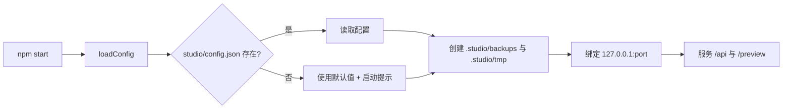
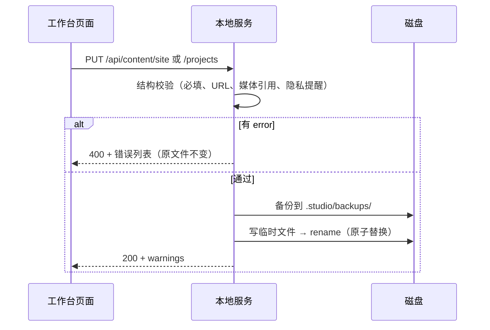
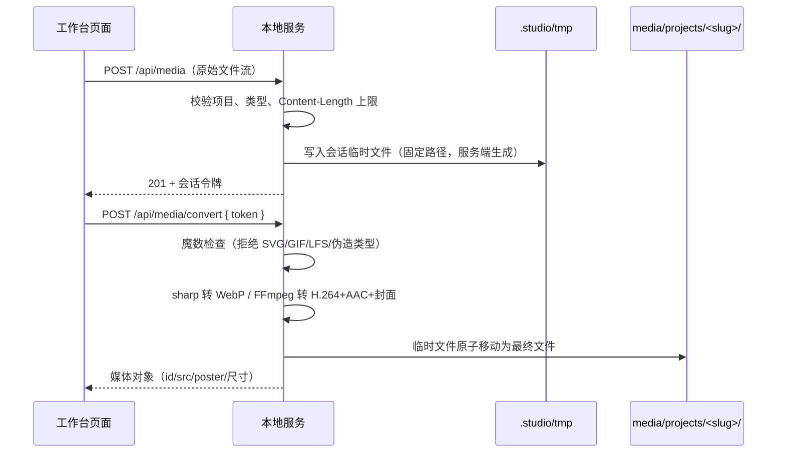
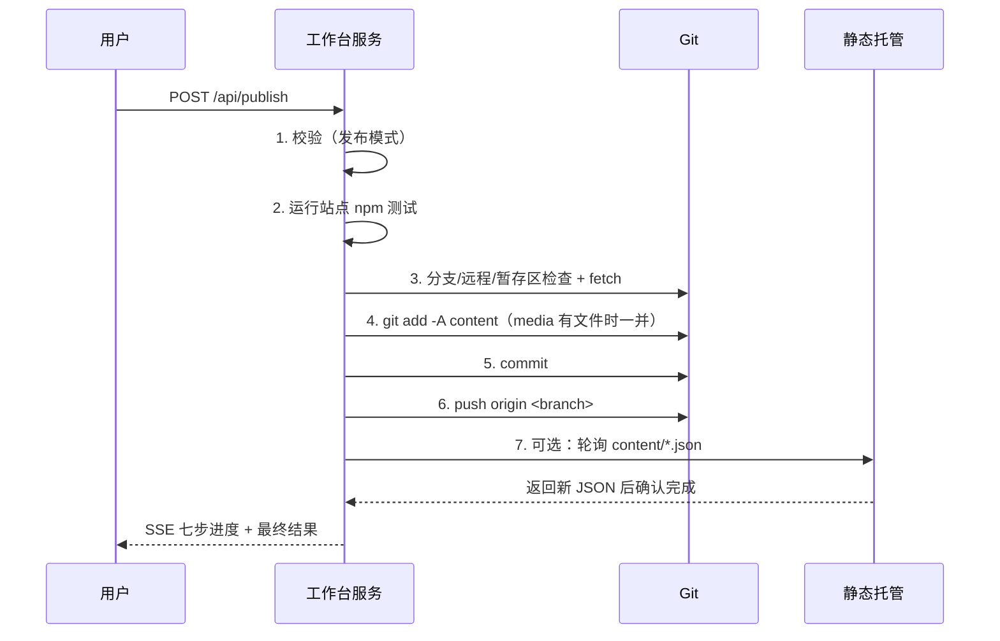
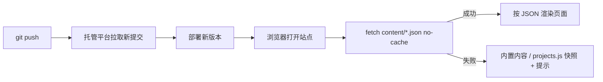

# 项目生效逻辑报告

这份报告说明：一次内容修改从「在工作台里编辑」到「正式站访客看到」经历了什么，以及每一步失败时会发生什么。

## 1. 参与者与数据流

| 参与者 | 职责 |
| --- | --- |
| 站点（仓库根） | 纯静态 HTML/CSS/JS；运行时读取 `content/*.json` 和 `media/` |
| 工作台页面（浏览器） | 编辑表单、上传媒体、预览、触发发布 |
| 工作台服务（本机 Node） | 写文件、处理媒体、校验、执行 Git 命令、推送 |
| Git 仓库（`origin`） | 保存内容提交；托管平台从这里拉取 |
| 静态托管 | 部署仓库内容；可选地被工作台轮询确认 |

核心原则：

1. **保存草稿 = 只写本地文件**，不产生 Git 提交。
2. **发布 = 校验 + 测试 + 只提交 `content/` 与 `media/` + 推送**。
3. **线上生效 = 托管平台拉取新提交后，浏览器重新读取 JSON**。

## 2. 目录与数据源

```text
（站点根）
index.html about.html projects.html project.html blog.html article.html
assets/app.js            运行时加载 JSON、渲染页面
assets/projects.js       内置作品快照（JSON 读取失败时兜底）
assets/styles.css        全站样式
content/site.json        个人资料 / 关于页 / 可选文章接口配置
content/projects.json    作品数据（状态、排序、文案、媒体引用）
media/projects/<slug>/   项目图片与视频
media/profile/avatar.webp 本地头像
tests/site.test.js       站点验收测试
studio/                  本地工作台（只服务本机）
studio/adapters/         适配器（portfolio 默认 + landing 示例）
examples/landing-site/   landing 示例站点
docs/                    内容契约、适配器接口与本报告
```

站点的唯一数据源是 `content/` 与 `media/`。`assets/projects.js` 只是同源读取失败时的降级快照，不会在工作台发布时自动同步（正式站 fetch 成功时不会用到它）。

### 适配器层

工作台核心不假设站点结构：`studio/adapters/<id>/index.js` 用一个 `BaseAdapter` 声明：

- **documents**：内容文件路径、对象/集合、标识字段、排序与状态字段；
- **mediaCollections**：媒体目录、每条目目录或扁平目录、引用字段、格式与限额；
- **avatar**：头像文件、目标 JSON 指针、尺寸；
- **publish**：暂存路径、锁定来源、部署探测目标、提交前缀；
- **manifest**：界面视图、表单字段、预览路由与帮助文案；
- **validate**：该模板特有的结构与跨字段校验。

核心按这些描述执行存储、备份、媒体处理、素材库、发布与通用 UI 渲染。`portfolio` 适配器对应本仓库模板；`landing` 适配器演示单文档 + 扁平图片集合 + 自定义前端组件。接口细节见 [adapter-api.md](adapter-api.md)。

## 3. 启动与配置



配置优先级：调用方覆盖（测试用） > 环境变量 > `studio/config.json` > 默认值。

| 配置 | 默认 | 作用 |
| --- | --- | --- |
| `adapter` | `portfolio` | 选择站点适配器 |
| `sitePath` | `..` | 被管理的站点仓库根 |
| `port` | `3737` | 本地端口 |
| `production.url` | `""` | 部署确认轮询地址；空则跳过 |
| `production.expectedRemote` | `""` | 期望的 `origin`；空则跳过远程比对 |
| `production.branch` | `main` | 发布分支 |
| `production.testScript` | `test` | 发布前运行的 npm 脚本 |
| `production.deployCheck.enabled` | `false` | 是否轮询确认部署 |

环境变量：`STUDIO_ADAPTER`、`STUDIO_SITE_PATH`、`STUDIO_PORT`、`STUDIO_SITE_URL`、`STUDIO_GIT_REMOTE`、`STUDIO_GIT_BRANCH`。

## 4. 编辑与保存（只改本地）



要点：

- **先校验后写入**：校验失败时磁盘上的旧文件保持原样。
- **写前备份**：每次保存都会在 `.studio/backups/` 留一份带时间戳的副本（最多保留 50 份）。
- **原子写入**：先写同目录临时文件，再 `rename`，避免半截文件。
- **项目改名**：PUT 时携带 `renames`；服务端确认旧 slug 未锁定后，重命名 `media/projects/<旧 slug>` 目录并改写媒体路径；写入失败会尝试回滚。
- **slug 锁定**：发布成功后把 slug 记入 `.studio/state.json`；之后拒绝改名或删除。

### 媒体上传（两段式）



- 图片：最长边 ≤ 1920px，质量逐级递减直到 ≤ 2 MiB。
- 视频：≤ 1080p、≤ 12 秒、≤ 18 MiB，输出 `+faststart` MP4，抽帧生成 WebP 封面。
- 头像：固定写 `media/profile/avatar.webp`，居中裁成 512×512，≤ 1 MiB，并同步更新 `content/site.json`。
- 请求数据不参与任何文件路径拼接；文件名由服务端生成。

## 5. 预览

- 右侧 iframe 指向 `/preview/`，服务工作台直接返回站点目录里的真实文件。
- 页面用 `fetch(path, { cache: "no-cache" })` 读取 `content/*.json`，所以预览看到的是**已保存**的草稿。
- 若 JSON 请求失败：页面保留内置静态内容 / `assets/projects.js` 快照，并在页头显示提示。
- 文章、评论依赖可选外部接口；本地预览中可能因未配置或 CORS 限制而失败，属正常现象。

## 6. 发布（真正上线的一步）



各步骤细节：

1. **校验**：字段结构、必填替代文本、媒体文件存在与体积、总量 ≤ 80 MiB、隐私规则（手机号、学号样式、简历文件、`javascript:` 等）、URL 协议。
2. **测试**：通过当前 Node 自带的 `npm-cli.js` 执行 `npm run <testScript>`（默认 `test`），不经过 shell；失败会展示日志尾部且不提交。
3. **Git 前置检查**：当前分支必须匹配；配置了 `expectedRemote` 时 `origin` 必须匹配；暂存区必须为空；有远程时先 `fetch` 并比较本地与 `origin/<branch>`。
4. **暂存**：按适配器的 `stagePaths`（默认 `content` 与 `media`）执行 `git add -A`；随后校验暂存路径全部位于这些发布路径内。
5. **提交**：消息形如 `content: 工作台内容更新 YYYY-MM-DD HH:mm`。
6. **推送**：`git push origin <branch>`；失败时本地提交保留。
7. **部署确认（可选）**：轮询 `${url}/content/site.json` 与 `projects.json`，规范化 JSON 后与本地比较；每 15 秒一次、最长 10 分钟。只允许 HTTPS、域名与配置一致，并拒绝解析到环回/私网/保留地址。

推送成功后，已发布项目的 slug 会被锁定。

### 失败分支

| 场景 | 工作台行为 |
| --- | --- |
| 内容/媒体校验失败 | 列出错误，不写文件、不提交 |
| 站点测试失败 | 显示日志尾部，不创建提交 |
| 暂存区已有无关文件 | 停止，列出文件 |
| 分支不符 / 远程不符 | 停止并提示当前值 |
| 本地落后或分叉 | 停止；不会自动覆盖、变基或强推 |
| 暂存路径越界 | 停止并列出异常路径 |
| 提交失败 | 停止，保留工作区 |
| 推送被拒 | 保留本地提交，提示检查凭据/网络 |
| 部署确认超时 | 标记"已推送待确认"，可稍后刷新站点 |
| 重复点击发布 | 返回 409，同一时间只允许一个发布任务 |

## 7. 线上生效链路



常见"改了没生效"的原因：

1. **只保存了草稿**：文件只在本机，尚未发布。
2. **发布失败**：看发布页哪一步标红（测试、分叉、推送等）。
3. **托管还在部署**：静态托管通常需要几十秒到几分钟。
4. **浏览器缓存**：HTML/CSS 可能被缓存，按 `Ctrl+F5` 强制刷新；内容 JSON 已使用 `no-cache`。
5. **改的是草稿项目**：`draft` / `archived` 状态不会展示，需要改为 `published`。
6. **头像不显示**：确认已发布、`media/profile/avatar.webp` 存在且 `site.json` 的 `avatar` 指向它。

## 8. 安全边界

- 服务只绑定 `127.0.0.1`，同时接受 `127.0.0.1` 与 `localhost` 主机名；不发送 CORS 头。
- 每次启动生成随机会话令牌；所有写接口必须携带 `X-Studio-Token`，并校验 `Host` 与 `Origin`。
- 静态文件通过「目录索引 Map」提供，请求路径只作为键，不参与文件路径拼接。
- 媒体路径只来自已保存项目的 slug；文件名由服务端生成；上传按魔数判断类型。
- 发布前备份、临时文件 + 原子替换；媒体先写临时目录再移动。
- 出站请求仅 HTTPS、仅配置域名、拒绝内网/环回解析、禁止重定向。
- Git 调用不经过 shell；npm 通过 `npm-cli.js` 直接执行；不保存任何 Token。
- 发布校验会拦截手机号、学号样式、简历文件链接与不安全协议。
- 适配器是本地受信任代码，拥有与服务端相同的权限；加载器只接受本地登记过的适配器 id，不提供远程加载。

## 9. 验证情况

- 站点测试：10 项（内容结构、媒体文件与限额、隐私扫描、路由与离线快照等）。
- 工作台测试：41 项（适配器契约与加载、manifest、保存/备份/原子写、slug 改名与锁定、图片/视频/头像处理、上传安全、发布流水线各失败分支，以及 landing 示例适配器的端到端发布）。
- 冒烟：模板工作台启动、预览、发布前校验均通过；landing 适配器的内容、媒体与发布路径按描述生效。
- 安全审计：2 条同一类启发式提示（文章接口地址来自 `site.json`，被视为浏览器端动态 URL）；代码已限制仅 HTTPS 并规范化地址，且该地址由站点所有者配置、无服务器端请求，属于需人工确认的提示项。

## 10. 一句话总结

**保存只改本地文件，发布才提交推送，托管拉取后浏览器读取 JSON 才真正生效。**
